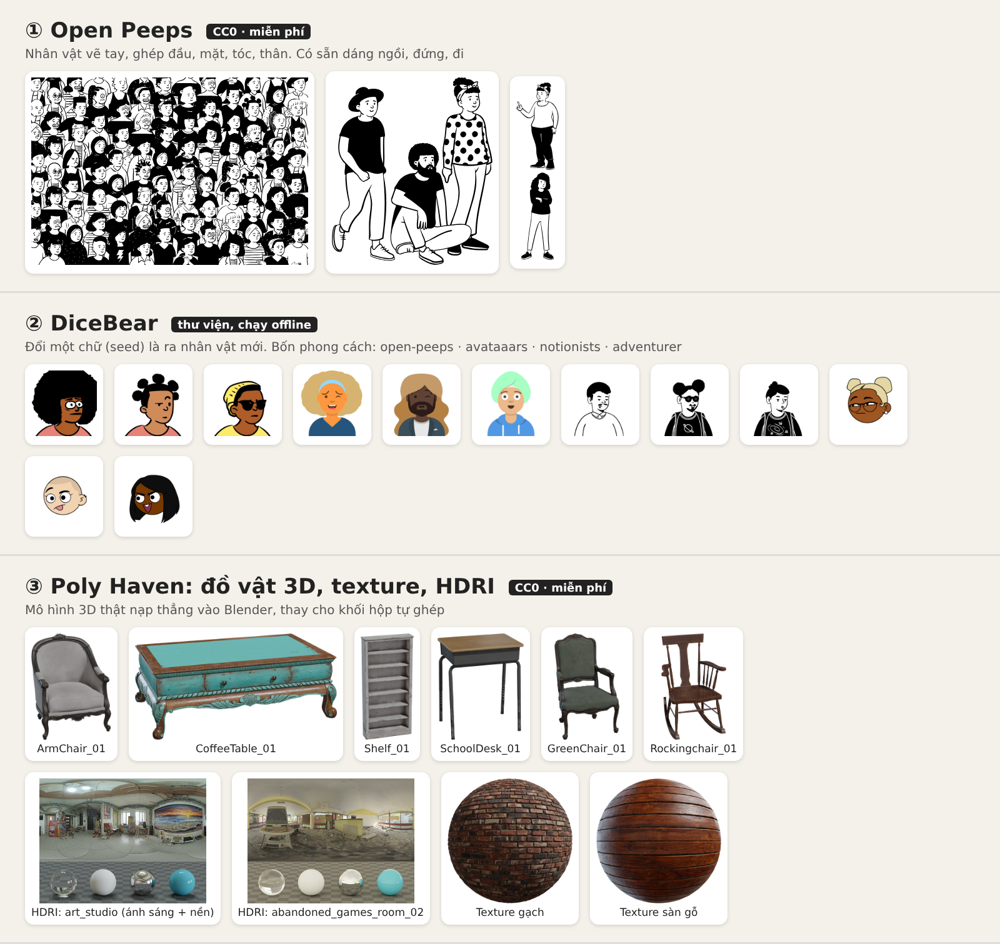

# Ghi chú dự án

## 1. Hướng render đã chọn: B (3D, Blender)

| Hướng | Mô tả | Trên GTX 1660 Super |
|---|---|---|
| A. 2.5D cắt giấy | Nhân vật PNG phẳng trong cảnh 3D | Rất nhẹ |
| **B. 3D toon / anime** | VRoid Studio + Mixamo + Blender shader toon | **Tốt, hướng chính** |
| C. AI chạy trên máy | ComfyUI + Stable Diffusion | Yếu: SD 1.5 ổn, SDXL chậm, video gần như không chạy nổi |

Ước lượng render: khoảng 1–3 giây mỗi khung 1080p với Eevee. Video 1 phút render on twos mất khoảng 30–45 phút.

Ảnh mẫu từ các nguồn miễn phí: 

## 2. Nguồn tài nguyên miễn phí

**Nhân vật**
- VRoid Studio: tạo nhân vật anime 3D, xuất VRM, nạp vào Blender bằng VRM Add-on.
- Mixamo: động tác có sẵn (cần tài khoản Adobe, miễn phí).
- Open Peeps (CC0), Humaaans: nhân vật 2D ghép theo bộ phận.
- DiceBear: avatar SVG chạy offline. Mỗi phong cách có giấy phép riêng.
- Meta AnimatedDrawings (MIT): cho tranh vẽ tay cử động.

**Cảnh (CC0)**: Poly Haven (mô hình, texture, HDRI), Kenney, Quaternius, ambientCG.

**Video nền**: Pexels, Pixabay.

## 3. Lịch sử Việt Nam: cần tự làm

Thư viện miễn phí gần như không có đồ Việt cổ. Cẩn thận lẫn đồ Trung, Nhật.

| Thứ | Có sẵn? | Cách làm |
|---|---|---|
| Thiên nhiên (tre, lúa, sông, núi) | Phần lớn có | Thư viện CC0 + Geometry Nodes |
| Kiến trúc (nhà sàn, đình, thành Cổ Loa, thuyền) | Rất ít | Dựng bằng Python trong Blender |
| Hoa văn (trống đồng, gốm) | Phải tự làm | Vẽ lại thành texture |
| Trang phục | VRoid không có kiểu Việt | Đổi texture; kiểu dáng khác thì sửa trong Blender |

- Chọn một **thời kỳ cụ thể** (Văn Lang–Âu Lạc, Lý–Trần, Lê, Nguyễn) và tìm tư liệu đúng thời kỳ đó.
- Phong cách nên cân nhắc: shader giả **tranh Đông Hồ** hoặc **hoa văn trống đồng**.
- AI (Stable Diffusion) chỉ dùng để lấy ý tưởng, không dùng làm thành phẩm.

## 4. Tối ưu

**Render**
- Render on twos (15 hình/giây), nội suy lên 30 bằng RIFE nếu cần.
- Render 720p rồi phóng lên 1080p bằng Real-ESRGAN (ncnn-vulkan).
- Chỉ render lại shot đã thay đổi (so hash tham số shot).
- SheepIt Render Farm cho các lần render dài.

**Cảnh**: instancing bằng Geometry Nodes, Decimate cho vật ở xa, nén mô hình bằng gltf-transform.

**Xuất video**: `-c:v h264_nvenc` trong FFmpeg.

## 5. Từ khóa tìm hiểu

- Thành phẩm: `VRoid Blender animation short`, `VRoid Mixamo animation`, `Blender anime short film`, `Blender toon shading animation`, `NPR animation Blender`, `MMD VRoid`
- Kênh và dự án: Dillongoo (Goo Engine), Lightning Boy Studio, Blender Studio (*Sprite Fright*, *Wing It!*, *Charge*)
- Kỹ thuật: `VRM addon for Blender`, `Mixamo to Blender tutorial`, `Blender anime toon shader tutorial`, `Rhubarb lip sync Blender`, `bpy automation`
- Lịch sử: `phục dựng cổ phục Việt`, `Đại Việt Cổ Phong`, `hoa văn trống đồng Đông Sơn`, `nhà sàn Đông Sơn`, `thành Cổ Loa phục dựng 3D`
